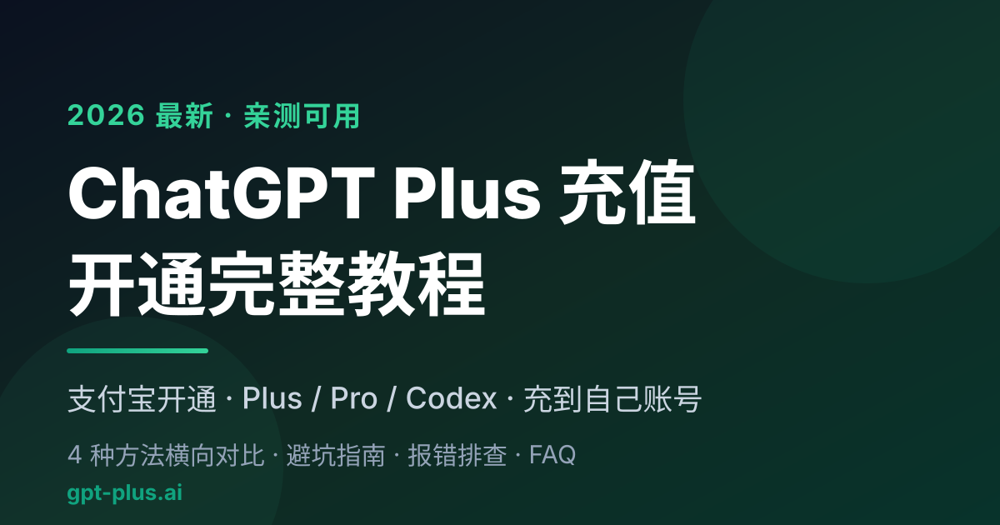

# 2026 ChatGPT Plus 充值 / 开通完整教程：支付宝开通 Plus、Pro、Codex（国内亲测）

> 最后更新：2026-06-26 ｜ 适用对象：国内想开通 / 续费 ChatGPT Plus、Pro、Codex 的普通用户
> 觉得有用就点个 ⭐ Star，方便以后回来查；地址会变，教程不会丢。

国内开通 ChatGPT Plus，难的从来不是「不会用」，而是卡在**付款**这一步。这篇是我自己这两年把虚拟卡、礼品卡、代充、共享账号全踩过一遍之后整理的实操笔记，不灌水、不卖关子，目标是让你用最少的折腾、最低的封号风险把 Plus（或 Pro / Codex）开到**自己的账号**上。

> **一句话结论（先给答案）**
> - 国内银行卡 100% 充不了 ChatGPT Plus，根子在 Stripe 的发卡行识别，不是改账单地址、换 IP 能绕过的。
> - 2025 下半年起主流海外虚拟卡平台因合规陆续退场，自己 DIY 这条路对普通人基本走死了。
> - 现在性价比最高、最省心的方式是**找一家正规的第三方代充 / 代开通平台**，用支付宝直接付人民币，几分钟开到自己账号。
> - 选平台只认三条硬指标：**支付宝可追溯支付 + 充到你自己账号（不要账号密码）+ 白纸黑字的售后质保**。

---

## 📚 目录

- [国内开通 ChatGPT Plus 为什么这么难？](#why-hard)
- [2026 年开通 Plus 一共有几种方法？（含对比表）](#methods)
- [方法一：海外虚拟信用卡](#method-vcc)
- [方法二：第三方代充 / 代开通（推荐）](#method-topup)
- [方法三：Apple App Store 礼品卡（仅 iPhone）](#method-giftcard)
- [方法四：共享账号（不推荐）](#method-shared)
- [哪种方法最适合你？30 秒决策](#decision)
- [怎么挑一家靠谱的代充平台？避坑清单](#how-to-choose)
- [代充开通 Plus 的完整步骤](#steps)
- [Plus、Pro 还是 Codex？该买哪个](#plus-vs-pro)
- [价格与性价比横向对比](#pricing)
- [国内充值最常见的报错排查](#troubleshooting)
- [常见问题 FAQ](#faq)
- [免责声明](#disclaimer)

---

## 国内开通 ChatGPT Plus 为什么这么难？

核心原因只有一个：**OpenAI 的收款通道（Stripe）会在发卡行层面识别中国大陆银行卡，并直接拒付**。这不是「填美国地址 + 挂美国 IP」就能糊弄过去的，因为拦截发生在你点「确认支付」之前的卡 BIN 校验环节。具体卡住国内用户的，主要是下面三道关：

- **发卡行 BIN 识别。** 每张卡前 6–8 位（BIN 段）能反查出发卡国家和银行。只要识别到中国大陆发行，无论招行全币种、中信白金还是各行 JCB，Stripe 一律拒付。
- **风控 IP 识别。** OpenAI 要求支付时落地在支持地区，且必须是**干净的住宅 IP**。机场常用的机房 IP（DataCenter）能打开网页，却会在支付页被判定为代理。
- **3D Secure 二次验证。** Visa / Mastercard 的境外交易往往要银行下发短信验证码，国内卡基本没接入这套体系，验证码收不到，这一关自然过不去。

说白了，自己硬充 = 同时在跟「支付源 + 网络环境 + 风控验证」三个系统死磕，每失败一次还会给账号累加一次风险分。这也是为什么越来越多人干脆把「付款」这一步外包出去。

---

## 2026 年开通 Plus 一共有几种方法？

目前能走通的就四条路：自己办海外虚拟信用卡、找第三方代充平台、用 Apple 礼品卡（仅限苹果用户）、买共享账号。它们在难度、速度、隐私、稳定性上差别很大，先用一张表给你结论，再逐个展开。

| 方法 | 操作难度 | 到账速度 | 隐私安全 | 稳定性 | 适合谁 | 推荐度 |
| --- | --- | --- | --- | --- | --- | --- |
| 海外虚拟信用卡 | 高（KYC + 充值 + 干净 IP） | 慢，失败要反复排查 | 中（身份信息交给发卡方） | 中（卡段 / IP 都可能触发风控） | 爱折腾、还要订其它海外服务 | ⭐⭐ |
| 第三方代充 / 代开通 | 低（支付宝付款，按提示走） | 快，几分钟 | 高（正规平台不要账号密码） | 高（平台负责海外通道 + 干净环境） | 想省心、要售后的普通人 | ⭐⭐⭐⭐⭐ |
| Apple 礼品卡 | 中高（切区 + 买卡 + 兑换） | 中，卡密异常会卡很久 | 中（看礼品卡来源） | 中（切区 / 风控都可能出问题） | 只用 iPhone 且熟悉切区 | ⭐⭐⭐ |
| 共享账号 | 低（买来就能登） | 快，但随时挂 | 低（聊天记录互相可见） | 低（多人异地登录极易封号） | 只想临时体验、不在意隐私 | ⭐ |

一句话：**普通用户想稳定开通，第一选择是正规的第三方代充 / 代开通平台。** 下面把每条路的真实门槛讲清楚。

---

## 方法一：海外虚拟信用卡（适合折腾党）

**核心逻辑**：注册一个海外发卡平台，拿到一张虚拟 Visa / Mastercard，再挂干净的美区住宅 IP 到 ChatGPT 官网绑卡支付。

⚠️ **2026 年的现实**：2025 下半年开始，国内常用的几家海外虚拟卡平台因跨境支付合规审查陆续停运，「国内充值 + 一键开卡 + 美区 IP」那套傻瓜玩法基本结束了。还在运营的几家，门槛全拉满：

- 开卡费 + 月费 + 充值手续费叠起来，一年多花的钱远不止订阅本身；
- 普遍要求过 KYC（身份证 + 人脸），跨境数据合规风险自己掂量；
- 很多只收 USDT，对没碰过加密货币的人极不友好；
- 平台跑路风险一直悬着，已经有不止一家头部平台清退，老用户余额基本无解。

**适合谁**：技术上不怵、未来还要订 Claude / Netflix / Spotify 等海外服务、愿意长期维护一套海外支付环境的人。**对只想开个 Plus 的普通用户，这条路性价比已经很低。**

---

## 方法二：第三方代充 / 代开通（目前最省心，推荐）✅

**核心逻辑**：你用支付宝 / 微信付人民币给正规代充平台，平台用企业级海外支付通道 + 干净住宅 IP，在 OpenAI 官方帮你完成订阅。你拿到的是**真·官方 Plus**，绑在你自己的 ChatGPT 账号上，全程不用把账号密码交出去。

**为什么这两年最流行？** 操作几乎为零（支付宝付一下）、几分钟到账、安卓 / iOS / 网页 / Mac 全平台通用，走的是官方支付链路，单纯因「代付动作」被封的概率极低。

我跑过好几家，目前自己长期在用、也敢推荐给朋友的是 **[GPT Plus（gpt-plus.ai）](https://gpt-plus.ai/?utm_source=github&utm_medium=readme&utm_campaign=tutorial)**，原因就一句话——**该有的都有，售后不跑路**：

- **支付方式**：支持支付宝，结算走 Stripe 安全支付，付人民币，几分钟搞定；
- **充值模式**：充到**你自己的账号**（独享，不是共享号），全程**不需要提供 ChatGPT 账号密码**，隐私从源头堵死；
- **覆盖范围**：Plus、Pro（$100 / $200 档）、Codex 都能开，升级后全平台通用；
- **质保售后**：明确写明**30 天质保、不封号、充值失败自动退款**，遇到问题有专属客服跟进，企业用户还能开发票；
- **入口透明**：官网 [gpt-plus.ai](https://gpt-plus.ai/?utm_source=github&utm_medium=readme&utm_campaign=tutorial) 套餐和价格明牌挂着，不用先加微信再「谈」。

> **为什么「充到自己账号」比共享号重要？** 共享号是多人同登一个账号，你的聊天记录、上传的文档代码对同号陌生人全可见，而且多人异地登录是 OpenAI 最典型的封号触发器。充到自己账号 = 数据私密 + 登录稳定，这一条几乎决定了你后续用得舒不舒服。

**优点**：真方便、速度快、风险低、全平台通用。
**注意**：依赖第三方，所以一定要选运营稳定、有真实质保承诺的平台；价格随汇率小幅浮动，但相比官方 $20 + 海外信用卡的门槛，整体性价比已经很高。**底线：任何让你交出 ChatGPT 账号密码的「代充」都别用。**

👉 想直接开通：[ChatGPT Plus / Pro 开通入口（gpt-plus.ai）](https://gpt-plus.ai/?utm_source=github&utm_medium=readme&utm_campaign=tutorial)

---

## 方法三：Apple App Store 礼品卡（仅限苹果用户）

**核心逻辑**：把 Apple ID 切到美区，买美区礼品卡充进余额，再在 iOS 版 ChatGPT App 里用苹果内购订阅 Plus。

**大致步骤**：
1. 把 Apple ID 切到美区（需要美国地址 / 邮编 / 电话，可虚拟；**切区前会清空原有订阅和余额，务必想清楚**）；
2. 买美区礼品卡（支付宝「出境 → 惠出境 → App Store & iTunes 充值」相对安全；淘宝 / 闲鱼卡密有买到黑卡的风险）；
3. 在 App Store 兑换礼品卡到美区 Apple ID；
4. iOS 版 ChatGPT App 内升级 Plus，支付方式选「Apple ID Balance」。

**优点**：走苹果官方内购，闭环在苹果生态内，iPhone 用户比较熟。
**注意**：只有 iPhone / iPad 能玩；切区有风险；2026 年苹果礼品卡风控收紧明显；**买到盗刷来的黑卡，整个 Apple ID 都可能被冻结**。续费 / 取消都得回苹果订阅设置里操作。

---

## 方法四：共享账号（不推荐）⚠️

**核心逻辑**：买一个商家提供的共享 Plus 账号，多人共用一个号。便宜是唯一优点，几十块就能「体验」。

但代价很大，逐条看清楚：
- **零隐私**：你和陌生人共用账号，**双方聊天内容互相可见**，贴工作文档 / 代码等于裸奔；
- **限额严重**：商家常限「3 小时 50 条」之类，体验很差；
- **极不稳定**：多人异地登录是封号触发器，账号随时挂；
- **没有售后**：卖家改密码跑路、店铺一夜消失都很常见。

**态度很明确：强烈不推荐。** 真要尝鲜，多花几十块买个正规平台的 Plus 月卡，体验和安全感是两个世界。

---

## 哪种方法最适合你？30 秒决策

- **想省心、又快又稳、预算正常** → 直接选**第三方代充 / 代开通**，是 99% 普通用户的最优解。
- **爱折腾、未来还要订其它海外服务** → 海外虚拟卡还能勉强走，但做好高门槛 + KYC + 干净 IP 的准备。
- **只用 iPhone、能接受切区** → Apple 礼品卡可选，但要扛住礼品卡作废和风控收紧的风险。
- **预算极低、完全不在意隐私** → 共享号能用，但我个人不碰，也不建议你碰。

不管选哪种，一个**干净稳定、能访问 ChatGPT 官网的网络环境**都是前提，这一条没解决，其它都白搭。

---

## 怎么挑一家靠谱的代充平台？避坑清单

代充这条赛道鱼龙混杂，小红书、闲鱼上「这个月开张下个月跑路」的个人商家一抓一大把。用下面 5 条硬指标交叉筛一遍，能滤掉绝大多数草台班子：

1. **看账号归属**：充到**你自己账号**的（独享）才安全，要你交账号密码、或卖「共享号」的直接 pass。
2. **看支付方式**：支持**支付宝 / 微信等可追溯渠道**的优先；只收 USDT、只能私下转账的，警惕。
3. **看运营年限和口碑**：域名注册满 1 年以上、社区有真实评价的优先，别碰刚上线的新店。
4. **看售后条款**：白纸黑字写明「**充值失败退款 + 质保期 + 客服跟进**」才算专业，含糊其辞的不要。
5. **看价格透明度**：官网把套餐和价格明牌挂出来的更可信；非要先加微信「谈价」的，套路多。

把这 5 条对着平台逐条打勾，[gpt-plus.ai](https://gpt-plus.ai/?utm_source=github&utm_medium=readme&utm_campaign=tutorial) 是我对照下来基本全中的一家——独享充值、支持支付宝、明确 30 天质保和失败退款、价格公开——所以放在这里当参考例子。**你也完全可以拿这张清单去对比别家**，标准比平台更重要。

---

## 代充开通 Plus 的完整步骤

正规自助平台的流程简单到几乎不需要教程，整体就四步：

1. **打开平台官网** → [gpt-plus.ai](https://gpt-plus.ai/?utm_source=github&utm_medium=readme&utm_campaign=tutorial)，选套餐（Plus / Pro 都支持）。
2. **用支付宝付款**，结算走 Stripe，付完即进入开通流程。
3. **按页面提示完成账号绑定**——正规平台只要你在已登录状态下提供官方会话信息，**不需要账号密码**。
4. **回 ChatGPT 刷新**，几分钟后 Settings → 订阅状态出现 Plus / Pro 标识，就成了。

整个过程比自己折腾虚拟卡、切区、买礼品卡省事太多，基本就是「下单 → 支付宝付钱 → 刷新出标识」。万一没出标识，先别慌，看下文报错排查或直接找平台客服。

---

## Plus、Pro 还是 Codex？该买哪个

一句话区分：**Plus 是大众款，Pro 是重度款，Codex 是给写代码的人用的。** 怎么选看你的使用强度：

- **ChatGPT Plus（官方 $20/月）**：日常问答、写作、查资料、轻度编程足够，性价比最高，**90% 的人选它就对了**。
- **ChatGPT Pro 5x（官方 $100/月）**：高频办公 + 编程，额度约是 Plus 的好几倍，适合每天重度用、还嫌 Plus 不够的人。
- **ChatGPT Pro 20x（官方 $200/月）**：全职编程 / 深度使用，几乎所有功能拉满，适合把 AI 当主力生产力工具的专业用户。
- **Codex**：OpenAI 的编程智能体，常和 Pro 订阅绑定使用，国内开通 / 额度重置也可以走代充。

不确定自己属于哪档？先从 Plus 起步，不够用再升级最稳妥。Pro / Codex 的开通和续费同样可以走代充：[查看 Pro 套餐与开通](https://gpt-plus.ai/chatgpt-pro?utm_source=github&utm_medium=readme&utm_campaign=tutorial)。

---

## 价格与性价比横向对比

很多人以为「官方才 $20，代充肯定坑」，其实算上海外卡的开卡费、月费、手续费和失败成本，自己 DIY 往往更贵也更累。下面这张表帮你把账算清楚（价格随汇率浮动，以平台官网结算页为准）：

| 套餐 | 官方价 | 代充参考价 | 适合人群 |
| --- | --- | --- | --- |
| ChatGPT Plus | $20/月 | ¥148 起 | 日常使用、轻度编程的大多数人 |
| ChatGPT Pro 5x | $100/月 | ¥900 左右 | 高频办公 + 编程 |
| ChatGPT Pro 20x | $200/月 | ¥1600 左右 | 全职编程 / 深度使用 |

> **怎么算才划算？** Plus 月付 ¥148 左右，和官方 $20 折算成人民币其实差不多，但你省掉的是海外卡的开卡费 + 月费 + 反复失败的时间成本。**如果想彻底告别每月续费**，可以直接上长期套餐（比如年付），平摊到每月更便宜。最新价格以 [官网](https://gpt-plus.ai/?utm_source=github&utm_medium=readme&utm_campaign=tutorial) 为准。

---

## 国内充值最常见的报错排查

如果你坚持自己用国内卡或虚拟卡硬充，下面这几条几乎是必踩的坑，对照排查能少给账号累加风险分。

**1. "Your credit card was declined"（信用卡被拒，最高频）**
99% 是因为用了国内发行的卡。Stripe 做 BIN 段识别，认出中国大陆发卡行就直接拒，跟 IP、账单地址、额度都无关。**结论：国内卡目前无解，别再换卡试了。**

**2. "Country not supported"（地区不支持）**
你的代理出口落在了 OpenAI 不支持的地区。要落在美国 / 英国 / 新加坡 / 日本等支持地区，且必须是干净的住宅 IP；机房 IP 会被直接判为代理。频繁切换节点国家也会被标记异常。

**3. 升级按钮点了没反应 / Stripe 支付页一直转圈**
多半是节点带宽小、丢包高，Stripe 的 JS 没加载全，或节点 IP 被临时风控。可换稳定的美区住宅节点、用无痕模式 + 清缓存重试。**重试 3 次还失败就停手**，再试容易被打风控标签。

**4. "Something went wrong, please try again later"**
OpenAI 临时风控收紧的信号，常见于同 IP 短时间多次尝试、虚拟卡 BIN 被标记。**遇到这个一般要冷却 24–48 小时再试**，短时间硬刚会被打「高风险账号」标签，连免费版都可能被限频。

**5. 礼品卡兑换提示 "This code has already been redeemed"**
你大概率买到了黑卡（盗刷或被举报来源）。一旦被 Apple 风控识别，整个 Apple ID 可能被余额清零、订阅取消，严重的连 iCloud 一起冻结。**别拿主力 Apple ID 去赌。**

**6. 充值成功但账号没有 Plus 标识**
先做三件事：① 完全退出重新登录或换无痕；② 确认你充的是哪个邮箱账号（多账号最容易付错号）；③ 进 Settings → 订阅状态确认。1 小时还没出，去邮箱搜 "Receipt from OpenAI" 确认是否真的扣款成功。

> **一句话总结**：国内自己硬充，本质是在和 OpenAI 风控死磕——**支付源不达标 + 网络环境不达标 + 每次失败都在累加风险分**，硬刚多次的代价往往是永久封号、聊天记录清零。更现实的姿势，是把「付款」这一步交给正规平台，自己只管用。

---

## 常见问题 FAQ

### 代充开通 Plus 适合技术小白吗？
非常适合。主流虚拟卡平台退场后，对小白来说正规代充几乎是唯一可行的路。流程就是付钱 → 选套餐 → 按提示开通，几分钟完事，不用懂任何技术，也不用把账号密码交给任何人。

### 通过代充平台开 Plus 会封号吗？
正规平台用企业级海外通道 + 干净住宅 IP，单纯因「代付动作」封号的概率非常低。绝大多数封号是用户后期网络节点不干净导致的，和代充本身无关。像 [gpt-plus.ai](https://gpt-plus.ai/?utm_source=github&utm_medium=readme&utm_campaign=tutorial) 这种还明确写了 30 天质保、不封号、失败退款。

### 淘宝 / 闲鱼上的个人代充能买吗？
强烈不建议。这些个人卖家为打价格战大量用黑卡或临期虚拟卡，OpenAI 风控一旦识别，账号大概率永久封禁、记录清空，而且店铺今天开明天关，售后基本指望不上。

### 代充需要我提供 ChatGPT 账号密码吗？
正规自助平台**不需要**。你只需在已登录状态下按指引提供官方会话信息即可。**任何要你交出账号密码的「代充」都别用**，这是隐私和账号安全的红线。

### 充值成功后能退款吗？
分情况：**充值失败 → 原路全额退款**；**已成功开通且账号正常使用 → 通常不支持无理由退款**（Plus 属虚拟数字商品，交付即视为消费完成）。具体以平台的退款政策为准。

### 到期了怎么续费？
大多数代充是「单月买断」，到期不自动扣款。到期前 3–5 天回原平台再下一单即可。想省心可以直接上长期套餐，平摊每月更便宜，也免去每月操作。

### 日常使用要注意什么？
代充帮你扫清的只是「付款」环节，账号能否长期稳定还看你自己：网络节点要干净稳定，别用免费 / 万人骑节点；别频繁跨国切换;提前 3–5 天续费，避免会员断档。

---

## 免责声明

本项目内容仅供信息参考，不构成任何投资 / 消费建议。所有第三方平台的服务条款、退款政策、适用人群以其官网为准，请在购买前自行确认适用性与风险。请遵守相关法律法规及各平台使用条款，所有操作与后果由用户自行承担。本仓库与 OpenAI 无任何官方授权、代理或合作关系。

---

*觉得这份教程有用，欢迎点 ⭐ Star 收藏、分享给需要的朋友。开通入口：[gpt-plus.ai](https://gpt-plus.ai/?utm_source=github&utm_medium=readme&utm_campaign=tutorial)*
