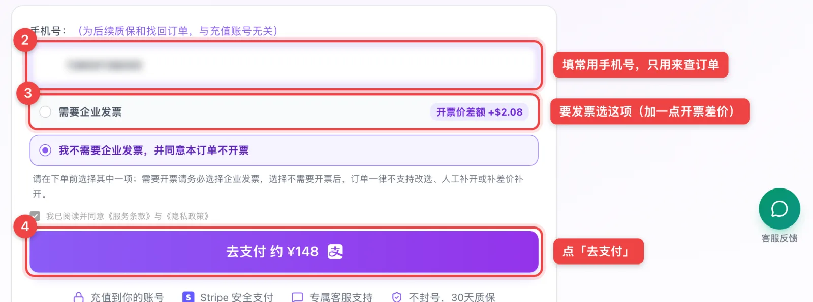
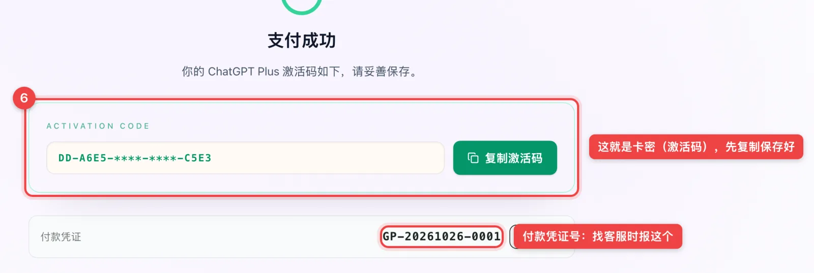
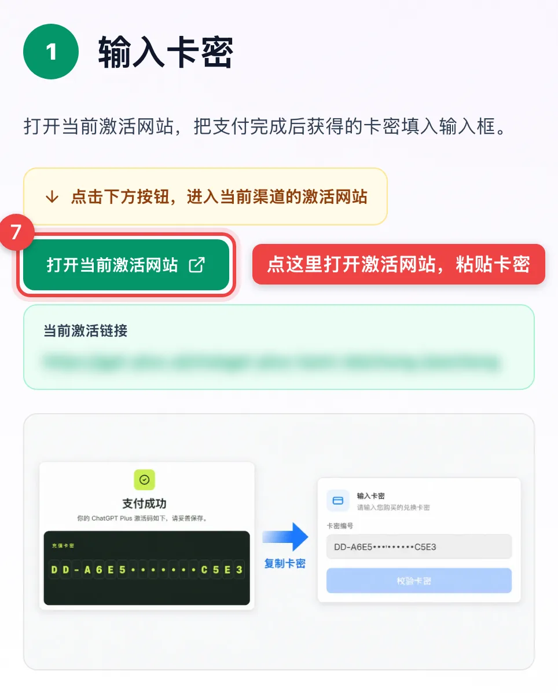
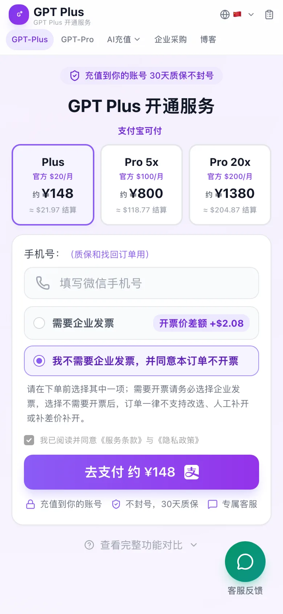
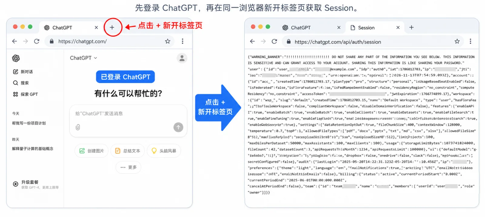
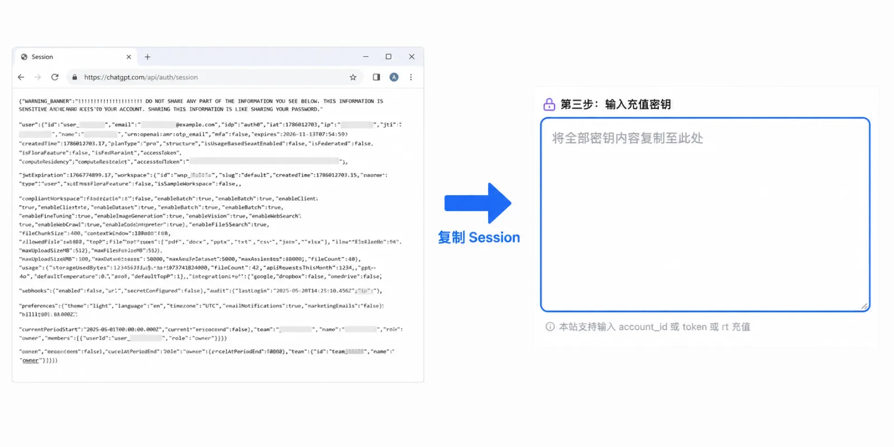
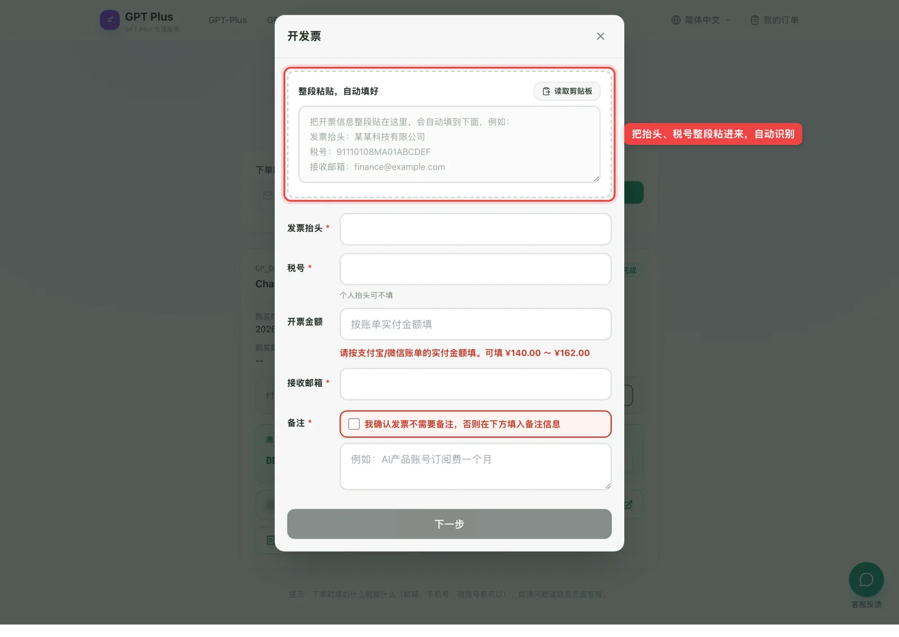

# 2026 最新 ChatGPT Plus 充值教程：支付宝开通 Plus、Pro、Codex（GPT-6 已上线，附实拍截图）

> 最后更新：2026-10-26（价格、截图、GPT-6 信息都已按这天核对）
> 觉得有用就点个 ⭐ Star，方便以后回来查；价格和流程有变化我会更新在这里。

10 月 7 日，OpenAI 把 **GPT-6** 推到了 ChatGPT 里：**Plus、Pro 用的是 GPT-6 Sol**，免费版和 Go 用的是 GPT-6 Luna。想用上 Sol，就得先开 Plus 或 Pro。

可很多人卡在了付款这一步：手上的 Visa、万事达卡点「升级」就被拒，虚拟卡要实名、要 USDT，礼品卡又要切区。这篇是我把虚拟卡、礼品卡、代充、共享账号都试过一遍之后整理的笔记，**每一步都配了真实页面截图**，照着点就能开通。

> **先给结论**
> - 没有美金卡、付款老被拒的，最省事的办法是**正规的第三方代充**：支付宝扫码付款，充到你自己的账号，1–3 分钟到账。
> - 挑平台只看三条：**能用支付宝等可追溯的方式付款 + 充到你自己的账号、不要密码 + 写明退款和质保规则**。
> - 我自己在用的是 **[GPT Plus（gpt-plus.ai）](https://gpt-plus.ai/?utm_source=github&utm_medium=readme&utm_campaign=tutorial)**：Plus 约 ¥148/月，能开发票，下文的截图都来自它。

*GPT Plus 充值页：Plus 约 ¥148、Pro 5x 约 ¥800、Pro 20x 约 ¥1380*

---

## 📚 目录

- [为什么 ChatGPT 付款老被拒？](#why-hard)
- [6 种 ChatGPT 充值方式对比（含对比表）](#methods)
- [ChatGPT 代充完整流程（8 张截图）](#steps)
- [卡密怎么用？激活这一步详细讲](#activate)
- [代充能开发票吗？](#fapiao)
- [Go、Plus、Pro、Codex 该买哪个？](#which-plan)
- [ChatGPT Plus 多少钱？价格表](#pricing)
- [代充靠谱吗？是怎么做到的？](#is-it-safe)
- [其他几种办法还值得用吗？](#other-methods)
- [到期怎么续费？怎么取消自动续费？](#renew)
- [常见报错怎么处理（中英文报错对照）](#troubleshooting)
- [常见问题 FAQ](#faq)
- [免责声明](#disclaimer)

---

## 为什么 ChatGPT 付款老被拒？

ChatGPT 网页版收款走的是 **Stripe**。它在你点「确认支付」之前，会先过三道检查：

- **认卡。** 卡号前 6–8 位能查出是哪个国家、哪家银行发的卡。很多人手上的 Visa、万事达，哪怕是全币种信用卡，到这一步就直接被拒，换账单地址、换网络都没用。
- **看网络。** 付款时所在的地区要是 OpenAI 支持的地区，而且最好是干净的住宅网络。很多加速节点用的是机房 IP，网页打得开，到付款页就被当成代理。
- **二次验证（3D Secure）。** 不少银行发不出这个验证码，或者验证页根本弹不出来，付款就卡死了。

所以自己硬充，等于同时跟「卡、网络、验证」三关较劲，而且**每失败一次，账号的风险分就涨一点**。这也是越来越多人干脆把付款这一步交给代充平台的原因。

---

## 6 种 ChatGPT 充值方式对比

现在能走通的办法一共六种，先看表，后面再一个个说：

| 充值方式 | 操作难度 | 到账速度 | 隐私安全 | 稳定性 | 适合谁 | 推荐度 |
| --- | --- | --- | --- | --- | --- | --- |
| **第三方代充（自助激活）** | 低：支付宝扫码，按页面提示操作 | 1–3 分钟 | 高：充到自己账号，不要密码 | 高：平台负责付款通道 | 想省事、要售后、要发票的人 | ⭐⭐⭐⭐⭐ |
| 海外虚拟信用卡 | 高：实名 KYC、USDT 充值、干净 IP | 不稳定，失败要反复排查 | 中：身份信息交给发卡平台 | 中：卡段、IP 都可能触发风控 | 还要订很多海外服务的人 | ⭐⭐ |
| App Store 礼品卡 | 中高：要美区 Apple ID、买卡、兑换 | 顺利的话较快 | 中：看礼品卡来源 | 中：切区、黑卡风险 | 只用 iPhone、会切区的人 | ⭐⭐⭐ |
| Google Play 订阅 | 中：要能用的 Google 账号和付款方式 | 较快 | 中 | 中：付款方式同样会被拒 | 安卓用户、已有可用付款方式 | ⭐⭐ |
| 低价区订阅（土耳其区、菲律宾区等） | 高：换区、当地付款方式 | 不稳定 | 中 | 低：跨区订阅容易被取消 | 爱折腾、能接受失败 | ⭐ |
| 共享账号 | 低：买来就能登 | 快，但随时失效 | 低：聊天记录别人都能看 | 低：多人异地登录易封号 | 只想临时体验 | ⭐ |

**一句话：没有美金卡、又想稳定用的，第一选择是正规的第三方代充。** 下面先把代充的完整流程走一遍，其他办法放在[后面](#other-methods)。

---

## ChatGPT 代充完整流程（8 张截图）

下面用 [gpt-plus.ai](https://gpt-plus.ai/?utm_source=github&utm_medium=readme&utm_campaign=tutorial) 演示，截图都是 2026-10-26 的真实页面（手机号、卡密已打码，二维码是示例）。

### 第 1 步：选套餐

打开 [gpt-plus.ai](https://gpt-plus.ai/?utm_source=github&utm_medium=readme&utm_campaign=tutorial)，三档套餐直接摆在首页。**一般人选 Plus 就够**；天天写代码、Plus 额度老用完的，再看 Pro 5x。

### 第 2 步：填手机号、选要不要发票，点「去支付」

- **手机号**：填你自己常用的就行，只用来查订单和售后，**和 ChatGPT 账号没关系**，不用填 ChatGPT 的邮箱。
- **发票**：要发票就选「需要企业发票」，会加一点开票差价；不要就选下面那项。⚠️ 选了不要发票，之后就不能再补开了，要开的这一步就选好。

### 第 3 步：支付宝扫码付款

点「去支付」会弹出支付宝二维码，**5 分钟内有效**。页面上按美元结算（Plus 是 $21.97），支付宝会自动换算成人民币扣款，大约 ¥148。

支付宝扫不了，右边可以切到**港币支付宝**或 **Stripe（银行卡）**。

### 第 4 步：付款成功，复制卡密

付完页面会自动跳到「支付成功」，上面那串就是**卡密（激活码）**，先点「复制激活码」，存到备忘录里。

下面的**付款凭证号**也记一下，找客服时报这个号，比报手机号快。

> 页面关了也不要紧，去 [我的订单](https://gpt-plus.ai/orders?utm_source=github&utm_medium=readme&utm_campaign=tutorial) 输入下单时填的手机号，卡密、凭证都能找回来（见[第 8 步](#step-8)）。

### 第 5–7 步：打开激活网站，粘贴卡密和 Session

支付成功页往下拉，就是一份 4 步的激活指引。点**「打开当前激活网站」**，把卡密粘进去，再按提示提交你的 Session。这一步是很多人第一次会卡住的地方，我放到[下一节](#activate)单独讲。

### 第 8 步：在「我的订单」里查订单、开发票

任何时候想查订单，打开 [我的订单](https://gpt-plus.ai/orders?utm_source=github&utm_medium=readme&utm_campaign=tutorial)，输入下单时填的手机号就能看到：订单状态、卡密、付款凭证、收款凭证，下单时选了要发票的，也是在这里点**「开发票」**。

### 手机上也一样

手机打开就是这个样子，选套餐、填手机号、点「去支付」会直接跳到支付宝，付完回来就是卡密页。**在微信里点开的话，先点右上角用浏览器打开**，微信里跳不了支付宝。

---

## 卡密怎么用？激活这一步详细讲

拿到卡密之后，激活一共三件事：

**① 打开激活网站，粘贴卡密，点「校验卡密」。**

**② 获取 Session：** 先在浏览器里登录 [chatgpt.com](https://chatgpt.com/)，然后在**同一个浏览器**里新开一个标签页，打开 `https://chatgpt.com/api/auth/session`，页面会显示一大段文字，**全选复制**。

**③ 回到激活网站，把这段 Session 粘进去，点提交。** 一般 1–3 分钟后，回 ChatGPT 刷新页面，左下角显示 Plus 就成了。

几条安全提醒，一定看一眼：

- **Session 只在激活页面里粘贴**，不要通过微信、QQ 发给任何个人。它相当于你这次登录的临时凭证。
- 正规代充**全程不要你的 ChatGPT 密码、邮箱密码和邮箱验证码**，谁要这些都别给。
- 充值前确认账号能正常登录。**账号是免费状态才能充**，Go 或别的会员还没到期的，先等到期（见[续费那一节](#renew)）。
- 3–5 分钟还没显示 Plus：先退出重新登录，或者换无痕窗口登录同一个账号；还不行就回激活网站，把 Session 再提交一次刷新状态。

---

## 代充能开发票吗？

能，这是很多公司报销的人最关心的。做法分两步：

1. **下单时**选「需要企业发票」（会加一点开票差价，Plus 开票价是 ¥162）；
2. **付款后**到 [我的订单](https://gpt-plus.ai/orders?utm_source=github&utm_medium=readme&utm_campaign=tutorial) 点「开发票」，把发票抬头、税号整段粘进去会自动识别，填好接收邮箱提交，开好的发票会发到邮箱。

公司要对公付款、批量采购、开增值税专票的，看 [企业采购](https://gpt-plus.ai/qiye-caigou?utm_source=github&utm_medium=readme&utm_campaign=tutorial)。

> 淘宝、闲鱼上的个人代充基本开不了正规发票，这也是我不推荐它们的原因之一。

---

## Go、Plus、Pro、Codex 该买哪个？

| 套餐 | 官方价 | 能用的 GPT-6 | 适合谁 |
| --- | --- | --- | --- |
| Go | 各地区不同，比 Plus 便宜 | Luna | 只聊天、翻译、改文案，免费版次数不够 |
| **Plus** | $20/月 | **Sol** | 大多数人：写作、查资料、轻度写代码 |
| **Pro 5x** | $100/月 | Sol，额度更多 | 天天写代码、Plus 额度老不够用 |
| Pro 20x | $200/月 | Sol，额度最多 | 全职编程、把 AI 当主力工具 |

几个要点：

- **Go 和 Plus 的区别**：Go 主要是比免费版多一些聊天额度；Plus 才有完整的深度研究和 Codex 额度。只要会写代码、查资料写报告，选 Plus。
- **Codex 不用单独买**，它用的是你的会员额度。Go 的 Codex 额度只够偶尔试试，Plus 能天天用，Pro 5x 的周额度大约是 Plus 的 9 倍。想了解 Codex 是什么、怎么登录，看 [Codex 介绍](https://gpt-plus.ai/codex?utm_source=github&utm_medium=readme&utm_campaign=tutorial)。
- **Pro 20x 注意**：现在新开的 $200 档按新版 10x 额度给，实际额度以账号 Usage 页面显示为准，下单前先看清页面说明。
- 拿不准就**先开 Plus**，不够再升级。Pro 各档在 [Pro 开通页](https://gpt-plus.ai/chatgpt-pro?utm_source=github&utm_medium=readme&utm_campaign=tutorial)。

---

## ChatGPT Plus 多少钱？价格表

按 2026-10-26 gpt-plus.ai 的标价（美元结算，人民币是约数，以付款页为准）：

| 套餐 | 官方价 | 代充价（不开票） | 开票价 |
| --- | --- | --- | --- |
| ChatGPT Plus | $20/月 | $21.97（约 ¥148） | ¥162 |
| ChatGPT Pro 5x | $100/月 | $118.77（约 ¥800） | ¥850 |
| ChatGPT Pro 20x | $200/月 | $204.87（约 ¥1380） | ¥1450 |

> **算一下账**：Plus 代充比官方 $20 多出来的那一点就是服务费，网站底部写明了上限（Plus 最多 $4.05）。自己办虚拟卡，开卡费、月费、充值手续费加上失败重来的时间，往往比这贵。

---

## 代充靠谱吗？是怎么做到的？

**怎么做到的**：平台手里有能正常付款的海外支付通道，你付钱给平台，平台用自己的通道替你的账号完成官方订阅。所以你拿到的是**官方的 Plus**，开在你自己的账号上，聊天记录、设置都不受影响。

**靠不靠谱，看平台**。对着下面 5 条逐条打勾，能筛掉大部分小作坊：

1. **充到你自己的账号**：要你交账号密码的、卖共享号的，直接不考虑。
2. **付款可追溯**：支持支付宝这类有记录的付款方式；只收 USDT、只能私下转账的，小心。
3. **规则写在明处**：退款、质保写清楚。比如 gpt-plus.ai 写的是「激活码未使用可申请全额退款，充值失败自动退款」，还有 30 天质保。
4. **价格公开**：官网直接标价的更可信，非要先加微信「谈价」的套路多。
5. **能开发票、有固定客服**：说明是正经做生意，不是今天开明天关的个人店。

**会不会封号？** 单纯因为「别人替你付款」被封的情况很少，封号多半是后来用了不干净的网络节点、多人共用账号这类原因。平台质保管的是会员中断，账号本身还得自己好好用。

---

## 其他几种办法还值得用吗？

### 海外虚拟信用卡

开一张海外虚拟 Visa/万事达，挂美区网络到 ChatGPT 官网绑卡。**2026 年这条路对普通人已经很难走**：开卡普遍要实名加人脸，很多平台只收 USDT，开卡费、月费、手续费叠起来不便宜，前几年还有不少平台停服跑路，余额拿不回来。

适合未来还要订很多海外服务、愿意长期维护一套海外支付环境的人。只为开个 Plus，不值。

### App Store 礼品卡

把 Apple ID 切到美区，买美区礼品卡充余额，在 iPhone 版 ChatGPT 里用苹果内购订阅。缺点：只有 iPhone/iPad 能用；切区前要处理掉原来的订阅和余额；**买到来路不明的礼品卡，整个 Apple ID 都可能被封**；续费、取消都得去苹果的订阅设置里弄。

### Google Play 订阅

安卓版 ChatGPT 里可以走 Google Play 订阅，但付款方式同样会被拒，绑卡这一关和网页版差不多难。已经有能用的 Google Play 付款方式的人可以试。

### 低价区订阅（土耳其区、菲律宾区等）

网上常见的「土耳其区便宜一半」，要换账号地区、找当地付款方式，**跨区订阅容易被取消**，取消了钱也不好要回来。不建议。

### 共享账号

几十块就能「体验」，但你和陌生人共用一个账号，**聊天记录、上传的文件互相都看得到**；多人异地登录很容易被封；商家改密码、跑路都很常见。**强烈不推荐**，尤其别在里面放工作内容。

---

## 到期怎么续费？怎么取消自动续费？

- **代充是单月的，到期不会自动扣钱。** 到期后回平台再下一单就行。
- **会员没到期不能叠加充值**。等到期、账号回到免费状态再充，前后最多断几分钟。
- **之前在官网或 App 里自己订过的**，要先关掉自动续费，不然到期会继续扣你的卡：
  - 网页版：ChatGPT 左下角头像 →「设置」→「账户」→ 管理订阅 → 取消；
  - iPhone：设置 → Apple ID → 订阅 → ChatGPT → 取消；
  - 安卓：Google Play → 头像 → 付款和订阅 → 订阅 → ChatGPT → 取消。
- 取消后会员能用到这个周期结束，聊天记录都还在。更多细节看 [ChatGPT Plus 取消订阅后还能用多久](https://gpt-plus.ai/blog/chatgpt-plus-cancel-subscription-refund-data-retention?utm_source=github&utm_medium=readme&utm_campaign=tutorial)。

---

## 常见报错怎么处理（中英文报错对照）

自己用银行卡或虚拟卡付款时，下面这几个报错最常见：

| 报错 | 中文界面显示 | 原因 | 怎么办 |
| --- | --- | --- | --- |
| Your card has been declined | 你的银行卡被拒绝了 | 发卡地区、卡段被拒，最常见 | 换卡、换地址都没用，别反复试 |
| （英文措辞不固定） | 付款未获批准 | 银行或 Stripe 风控拦截 | 停手，换付款方式 |
| We were unable to authenticate your payment method | 无法验证你的付款方式 | 3D Secure 验证失败 | 银行发不出验证码的卡基本过不去 |
| Country not supported | 不支持你所在的国家/地区 | 网络出口在不支持的地区 | 用支持地区的稳定网络，别来回切节点 |
| Something went wrong | 出了点问题 | 短时间尝试太多次被风控 | 冷却 24–48 小时再试 |
| 付款页一直转圈 / 打不开 | — | 网络不稳、广告拦截插件挡了 Stripe | 无痕窗口、关插件、换稳定网络 |

还有两种不是付款报错，但也常问：

- **续费时提示「你的银行卡被拒绝了」**：原来能扣的卡续费失败了，多半是卡过期、额度不够或者被风控。代充是单月的，不存在续费扣款这个问题。
- **充值成功但没显示 Plus**：先退出重新登录、换无痕窗口；确认充的是不是当前登录的这个账号；还不行拿付款凭证号找客服。

更完整的排查步骤看 [ChatGPT Plus payment failed 怎么办](https://gpt-plus.ai/chatgpt-plus-payment-failed?utm_source=github&utm_medium=readme&utm_campaign=tutorial)。

> **一句话**：同一张卡被拒，再试十次也还是被拒，而且每次失败都在给账号加风险分。与其硬试，不如把付款这一步交出去。

---

## 常见问题 FAQ

### ChatGPT 代充需要提供账号密码吗？
不需要。下单只填一个手机号，激活时在激活页面里粘贴 Session 就行。**要密码、要邮箱验证码的，一律别用。**

### 充值多久到账？
提交 Session 后一般 1–3 分钟。3–5 分钟还没显示，按上面[激活那一节](#activate)的方法刷新。

### 卡密有有效期吗？没用能退吗？
gpt-plus.ai 的规则是：**激活码没用过可以申请全额退款，充值失败自动退款**。会员已经开通生效的属于数字商品，不再退款，30 天内出现不是你造成的会员中断，按质保处理。

### 卡密找不到了怎么办？
去 [我的订单](https://gpt-plus.ai/orders?utm_source=github&utm_medium=readme&utm_campaign=tutorial) 输入下单时的手机号，卡密、付款凭证都在。

### 支付宝能付吗？微信呢？
支付宝能付（扫码或手机跳转），还可以选港币支付宝、银行卡（Stripe）。

### 代充能开发票吗？
能，下单时选「需要企业发票」，付款后在订单里填抬头税号，详见[开发票](#fapiao)。

### Plus 能用 GPT-6 吗？能用 Codex 吗？
都能。Plus 在 ChatGPT 里用的是 GPT-6 Sol，Codex 用会员额度，App、命令行、网页版都能登录。

### 已经开了 Go，能直接充 Plus 吗？
不能叠加。先在 ChatGPT 里取消 Go 的自动续费，等到期回到免费版再充 Plus，聊天记录都还在。

### 淘宝、闲鱼上的个人代充能买吗？
不建议。价格低的很多用的是来路不明的卡，账号容易出事；很多要你交账号密码；店铺说关就关，售后和发票都没有着落。

### 手机能充吗？
能，手机打开 [gpt-plus.ai](https://gpt-plus.ai/?utm_source=github&utm_medium=readme&utm_campaign=tutorial) 下单，付款会直接跳支付宝。激活那一步要复制 Session，用电脑操作更方便。

---

## 免责声明

本项目内容仅供信息参考，不构成消费建议。文中价格、套餐、规则以各平台官网当时显示为准，购买前请自行确认适用性与风险。请遵守相关法律法规及各平台使用条款，所有操作与后果由用户自行承担。本仓库与 OpenAI 没有任何官方授权、代理或合作关系，「ChatGPT」「OpenAI」等商标归其权利人所有。

---

*觉得这份教程有用，欢迎点 ⭐ Star 收藏、分享给需要的朋友。开通入口：[gpt-plus.ai](https://gpt-plus.ai/?utm_source=github&utm_medium=readme&utm_campaign=tutorial)*
