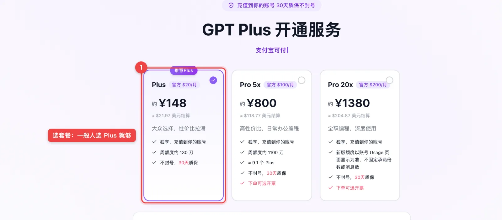
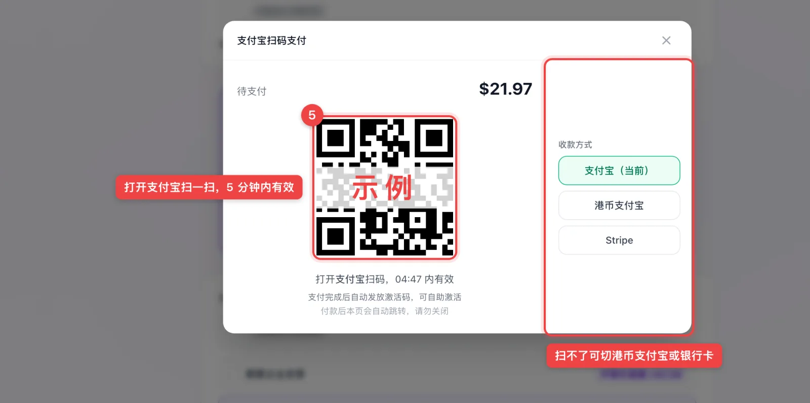

# ChatGPT 提示「你的银行卡被拒绝了」怎么办？原因和 3 种解决办法（2026）

> 最后更新：2026-10-26
> 本文属于 [ChatGPT Plus 充值教程](../README.md) 系列。

点了「升级到 Plus」，填好卡号，结果页面弹出一行红字：

- 中文界面：**你的银行卡被拒绝了**
- 英文界面：**Your card has been declined** / **Your card was declined**

先说结论：**这个报错多半不是卡里没钱，换账单地址、换网络、再试几次基本都没用。** 同一张卡被拒，再试十次也还是被拒，而且每失败一次，账号的风险分都在往上涨。

下面讲清楚为什么会被拒，以及还能怎么开通。

---

## 为什么会被拒？

ChatGPT 网页版收款用的是 **Stripe**。你点「确认支付」之前，它会先做三道检查，任何一道没过都会弹这个报错：

| 检查 | 它在看什么 | 被拒的常见情况 |
| --- | --- | --- |
| **认卡** | 卡号前 6–8 位能查出发卡国家和银行 | 发卡地区不被支持，全币种卡、白金卡也一样被拒 |
| **看网络** | 付款时的网络出口在哪、是不是机房 IP | 加速节点用的是机房 IP，网页能打开，付款时被当成代理 |
| **二次验证（3D Secure）** | 银行要给你发验证码确认 | 银行发不出验证码，或验证页根本弹不出来 |

第一种最常见。这一关是按卡号判断的，跟你填的地址、额度、网络都没关系，所以「换个美国地址再试」没用。

---

## 先排除这几种「卡本身」的问题

如果你的卡平时在海外网站能正常刷，再看看是不是这几个原因：

1. **卡过期了或额度不够**：续费时突然被拒，多半是这个。
2. **银行把这笔交易当成可疑交易拦了**：打银行客服电话，让他们放行境外交易再试一次。
3. **短时间试太多次**：页面可能变成「出了点问题」（Something went wrong），这时候先停 24–48 小时。

排除完还是被拒，就别再拿同一张卡试了。

---

## 还能怎么开通？3 种办法

### 办法一：第三方代充（最省事）

把付款这一步交给代充平台：你用支付宝付款，平台用自己能正常付款的通道，给**你自己的账号**开通官方 Plus。不用交账号密码，一般 1–3 分钟到账。

以 [gpt-plus.ai](https://gpt-plus.ai/?utm_source=github&utm_medium=article&utm_campaign=tutorial&utm_content=card-declined) 为例，流程就三步：选套餐 → 支付宝扫码 → 拿卡密去激活页面激活。

每一步截图和激活方法，看[完整教程](../README.md)。

### 办法二：换一张能用的海外卡

如果你本来就有海外银行发的卡、并且在支持的地区，换卡是最直接的。虚拟卡也是一种，但现在开卡普遍要实名、很多只收 USDT，卡段和网络照样可能被拒，只为开 Plus 不太划算。

### 办法三：App Store 礼品卡

用美区 Apple ID 加美区礼品卡，在 iPhone 版 ChatGPT 里订阅。只能在 iPhone/iPad 上用，而且买到来路不明的礼品卡，整个 Apple ID 都可能被封。

---

## 常见问题

### 换了个美国地址还是被拒，为什么？
被拒是因为卡号，不是因为地址。地址填什么都改变不了卡号查出来的发卡行。

### 一直被拒会不会封号？
单次被拒不会，但反复失败会让账号风险分变高，之后再付款更难。建议别硬试。

### 以前能付，现在续费被拒了？
多半是卡过期、额度不够或者被银行风控。先查卡；如果你改用代充，代充是单月的，到期不会自动扣款，也就不存在续费被拒的问题。

### 代充需要提供 ChatGPT 密码吗？
不需要。正规代充全程不要你的密码和邮箱验证码，谁要这些都别给。

---

## 相关文章

- [ChatGPT 提示「付款未获批准」怎么办？](./chatgpt-payment-not-approved.md)
- [GPT-6 上线了：Sol、Luna、Astra 有什么区别，要开哪个会员？](./gpt-6-sol-luna-astra.md)
- [ChatGPT Go、Plus、Pro 怎么选？](./chatgpt-go-plus-pro-difference.md)
- [ChatGPT Plus 充值完整教程（支付宝开通 Plus、Pro、Codex）](../README.md)

更多付款报错的排查步骤，可以看 [ChatGPT Plus payment failed 怎么办](https://gpt-plus.ai/chatgpt-plus-payment-failed?utm_source=github&utm_medium=article&utm_campaign=tutorial&utm_content=card-declined)。

---

*本文仅供参考，价格和规则以各平台官网为准。本仓库与 OpenAI 没有任何官方授权、代理或合作关系。开通入口：[gpt-plus.ai](https://gpt-plus.ai/?utm_source=github&utm_medium=article&utm_campaign=tutorial&utm_content=card-declined)*
