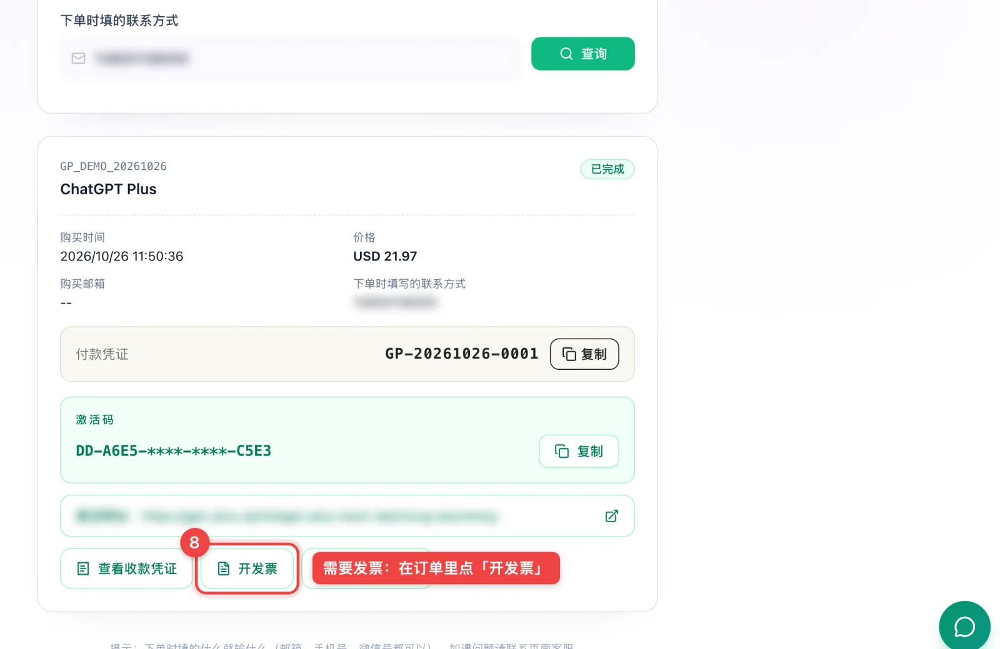

# ChatGPT Plus 到期怎么续费？怎么取消自动续费（网页、iPhone、安卓）

> 最后更新：2026-10-26
> 本文属于 [ChatGPT Plus 充值教程](../README.md) 系列。

先分清你的 Plus 是怎么开的，续费方法不一样：

| 你是怎么开的 | 到期会自动扣钱吗 | 怎么续 |
| --- | --- | --- |
| 自己在官网、App 里用卡订阅 | **会**，每月自动扣 | 不用管；不想续就取消自动续费 |
| 代充 | **不会**，单月的 | 到期后再下一单 |

---

## 代充开的 Plus：到期再下一单

1. **等到期**：会员没到期不能叠加充值。等账号回到免费状态再充，前后最多断几分钟。
2. **再下一单**：回平台选套餐、付款、拿卡密激活，和第一次一样。

以 [gpt-plus.ai](https://gpt-plus.ai/?utm_source=github&utm_medium=article&utm_campaign=tutorial&utm_content=renew) 为例，上一单的订单记录在 [我的订单](https://gpt-plus.ai/orders?utm_source=github&utm_medium=article&utm_campaign=tutorial&utm_content=renew) 里，输入下单时的手机号就能看到。

完整的下单和激活步骤看[完整教程](../README.md)。

---

## 自己订阅的：怎么取消自动续费

之前自己在官网或 App 里订过、现在想改用代充的，**要先取消自动续费**，不然到期还会继续扣你的卡（或者扣款失败，提示[「你的银行卡被拒绝了」](./chatgpt-card-declined.md)）。

在哪订的，就去哪取消：

### 网页版（chatgpt.com）
ChatGPT 左下角头像 → **设置** → **账户** → 管理订阅 → **取消**。

### iPhone / iPad（通过苹果订阅的）
手机 **设置** → 点最上面的 **Apple ID** → **订阅** → **ChatGPT** → **取消订阅**。

### 安卓（通过 Google Play 订阅的）
打开 **Google Play** → 右上角头像 → **付款和订阅** → **订阅** → **ChatGPT** → **取消订阅**。

**取消后**：会员能用到这个周期结束，聊天记录都还在。到期回到免费版后，再用代充开就行。

更多细节看 [ChatGPT Plus 取消订阅后还能用多久](https://gpt-plus.ai/blog/chatgpt-plus-cancel-subscription-refund-data-retention?utm_source=github&utm_medium=article&utm_campaign=tutorial&utm_content=renew)。

---

## 换套餐：Go 换 Plus、Plus 换 Pro

会员不能叠加，换套餐都是同一个思路：**取消旧的自动续费 → 等到期回到免费版 → 开新的。**

拿不准换哪个，看 [ChatGPT Go、Plus、Pro 怎么选？](./chatgpt-go-plus-pro-difference.md)

---

## 常见问题

### 到期后聊天记录会丢吗？
不会。会员到期只是回到免费版，聊天记录都还在。

### 能不能提前续，避免断掉？
会员没到期不能叠加充值。等到期再充，前后最多断几分钟。

### 取消订阅能退款吗？
OpenAI 一般不退当期的钱，取消后能用到周期结束。代充的话，以平台规则为准，比如 gpt-plus.ai 是激活码没用过可以全额退款、充值失败自动退款。

### 续费也想开发票？
每一单都能单独开，下单时选「需要企业发票」。看 [ChatGPT 代充能开发票吗？](./chatgpt-daichong-fapiao.md)

---

## 相关文章

- [ChatGPT Go、Plus、Pro 怎么选？](./chatgpt-go-plus-pro-difference.md)
- [ChatGPT 代充能开发票吗？](./chatgpt-daichong-fapiao.md)
- [ChatGPT 提示「付款未获批准」怎么办？](./chatgpt-payment-not-approved.md)
- [ChatGPT Plus 充值完整教程](../README.md)

---

*本文仅供参考，价格和规则以各平台官网为准。本仓库与 OpenAI 没有任何官方授权、代理或合作关系。开通入口：[gpt-plus.ai](https://gpt-plus.ai/?utm_source=github&utm_medium=article&utm_campaign=tutorial&utm_content=renew)*
